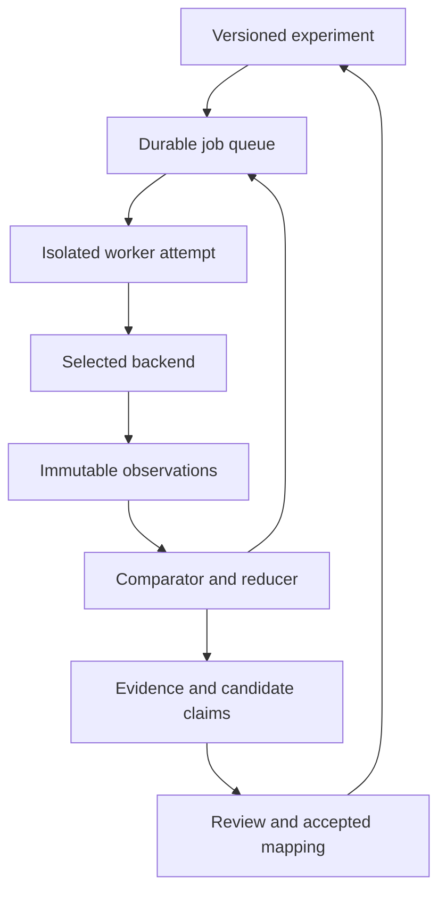

# Simulator and continuous research lab

> Long-term architecture reference. The active PC plan limits immediate work to bounded local slices; this design is not a request to build all services.

## Upstream foundation

The first worker executes [Max Evans’s Bosman Edition](https://github.com/maxevans60/cm0102-bosman-edition). Its observations are attached to the inventory imported from [Max Evans’s function map](https://github.com/maxevans60/cm0102-function-map). Follow [the integration contract](../research/UPSTREAM_INTEGRATION.md); source pins, original binary identity and adapter capability checks are mandatory.

## Purpose and success

The lab is a reusable experimental system for the entire game. A useful overnight result is a reproducible counterexample, a newly exercised branch, a supported field interpretation or a verified Rust behaviour. Merely completing 10,000 matches is not evidence of reconstruction progress.

The first deployed version runs the existing game through an adapter. It does not wait for the Rust game to exist. Rust later becomes another backend under the same experiment protocol. Initial long-running mode is sequential, single-worker and private; concurrency expands only after measurement.

## Backends and capabilities

| Backend | Execution | Evidence it can supply | Initial limitation |
|---|---|---|---|
| `original-windows` | Official executable in a pinned Windows environment, scripted interaction/debugging | Whole-game baseline and targeted observation | Automation/extraction is not yet built; may need separate Windows host |
| `original-function` | Selected original routines under Unicorn with controlled registers/memory/imports | Exact small-function output, state and RNG comparisons | Only valid for captured dependencies; not a complete Windows/game emulator |
| `bosman-native` | Pinned translated executable on Linux, SDL dummy drivers and scripted input | Throughput, repeatable scenarios, instrumentable transitions, season stability | Upstream patches/hooks and layout effects must be calibrated |
| `rust-native` | Our Rust core in an isolated child process | Replacement behaviour and differential results | Added incrementally; absent modules report unsupported |
| `rust-wasm` | Same core in browser Web Worker | Browser/native equivalence and player workflows | Browser memory and host integration require separate tests |

Backend capability discovery is explicit: load-save, create-game, set-seed, capture-rng, function-trace, detailed-match, quick-result, advance-day, inject-command, export-state. Unsupported operations reject before execution; never silently fall back to a different engine path.

Full-play and quick-result are separate job types and coverage strata. The inspected upstream full-play runner keeps the match-engine switch on, whereas its soak runner sets `RECOMP_SEASON_JUMP`. Even full-play must record which path the targeted fixture actually took; background fixtures may follow different policies. Use targeted match scenarios for detailed-engine claims.

## Experiment flow

A scenario declares an initial fixture or new-game setup, ordered commands, checkpoints, expected path, observation schema, resource budget and comparison class. A campaign chooses a finite set or bounded generator of scenarios/seeds. Campaigns are versioned and can replenish a queue on the VPS; they are not ChatGPT reminder automations.

Three complementary workloads:

1. **Micro differential cases:** call a routine with captured valid state; compare return values, written memory, RNG consumption and relevant side effects. Good for dates, rankings, RNG, money calculations and narrowly scoped decisions.
2. **Controlled journeys:** load a checkpoint and issue a transfer offer, select training, renew a contract, change tactics, advance a day, play a fixture or save/reload. Observe the earliest changed event/state, not just the final score.
3. **Long-world campaigns:** advance seasons, competition stages, international windows and careers to expose lifecycle failures. Quick-result campaigns cover world integration; detailed campaigns cover match behaviour separately.

Holiday runs do not exercise all player decisions. A coverage matrix must include active management, rejected actions, screen transitions and human-versus-AI paths.

## Job identity and durable execution

A logical experiment digest hashes canonical manifest bytes including scenario version, input hashes, backend/build identity, mode, RNG initial state/seed, clock policy and comparator version. Each physical attempt has a distinct ID. Run ID is not a claim that duplicate work cannot occur.

Planned execution lifecycle: `queued -> leased -> running -> collecting -> succeeded`, with `failed` and `cancelled` alternatives and a separate terminal reason. Comparison verdict is independent: `not-run`, `equal`, `different`, `inconclusive` or `not-comparable`. A mismatch is not an execution state. See [runtime contracts](RUNTIME_CONTRACTS.md) for endpoint checks, protocol, command replay and lease/resource fencing.

Lease claim: short PostgreSQL transaction selects eligible job with `FOR UPDATE SKIP LOCKED`, increments fencing token, records worker ID/expiry and commits. Heartbeats extend a live lease. Long simulation never holds a DB transaction. Reclaim after expiry creates a new attempt/token. Completion uses a compare-and-set on job ID/token; stale workers can upload attempt artifacts but cannot replace accepted results. Exactly-once result acceptance is a transactional goal; execution is at least once.

Artifacts are written to an attempt directory, hashed, atomically published and then referenced in the completion transaction. A collector reconciles unreferenced uploads with a grace period. Cancellation records desired state; worker terminates its process group/container after a grace period and records partial artifacts. Test lease races, lost DB connection, worker kill during save, restart during upload and disk-full publication.

Retries: infrastructure failures get a bounded retry with backoff; deterministic mismatches create a reproducer, not endless retry. Repeated crashes of the same signature trigger quarantine and at most one diagnostic retry. Rate-limit retries and campaign generation. Jobs have priority aging and resource class to avoid starving large/slow cases.

## Reproducibility manifest

Required fields: schema version, experiment/attempt IDs, scenario digest, repo commits, compiler/flags, backend binary and original executable hashes, data/save/asset hashes, all patch digests, adapter version, OS/CPU architecture, container digest or VM identity, locale/timezone, configuration, mode/feature profile, selected nations/database/language, initial and final RNG state where supported, seed, simulated clock policy, command stream digest, observation/comparator versions, instrumentation level, limits and artifact digests.

Unsupported state capture is recorded as unavailable. If exact capture is required by the experiment, reject it. Capture process address layout/allocator policy where relevant. Persist the RNG table checksum and algorithm version, not just a seed. Keep the actual proprietary table private.

The adapter constructs an allowlisted environment instead of inheriting arbitrary `RECOMP_*` variables. In a full-play job, unexpected `RECOMP_SEASON_JUMP` is an error. Initial baseline explicitly requests changing-rules off and matching 2001 data, but this flag alone is not proof of vanilla behaviour: audit the hook set and compare against the original. Each attempt gets a private writable user/config/save directory and read-only inputs.

## Observability without excessive tracing

Level 0: outcome, timings, invariant violations and checkpoint hashes. Level 1: function/block hit bitmaps and selected counters. Level 2: subsystem events, selected fields, RNG call counts/callsite IDs. Level 3: bounded function entry/exit, argument and memory-write traces around a divergence. Level 4: instruction tracing for a tiny reduced case only.

First instrument translated C at stable original address boundaries. Indirect-call targets and unwind/runtime regions need explicit classification; do not equate generated host-C source coverage with original branch coverage. Original debugger/Unicorn observations cross-check key interpretations. Traces have maximum bytes/events, record drop counts and never silently truncate a required comparator input. Exhaustion gives `inconclusive`.

Instrumentation A/A calibration compares traced and untraced runs from the same snapshot. Where logging changes allocation or scheduling, buffer outside emulated game state, defer output, and test again. A Ghidra headless project is generated per input/build; parallel analyses use separate projects to avoid corruption.

## Comparing random games

Same inputs plus the same seed are insufficient until all randomness sources, call order and layout-sensitive state are controlled. Start with A/A self-replay on each backend, then A/B comparisons. Never seed both programs and assume a matching schedule of RNG calls.

Exact cases compare the first divergent checkpoint, then narrow to event/RNG call/function. Snapshot replays support prefix bisection if checkpoint restore has itself been validated. Reduction preserves scenario validity and the divergent predicate; otherwise label it an approximate reproducer.

For non-aligned whole-game cases, define distributional hypotheses before running. Use fixed seed corpora, matched settings, planned effect-size thresholds and confidence intervals. Repeated matches from one evolving career are clustered observations, not independent samples. A hundred matches is an exploratory pilot; choose later sample sizes from variance and desired sensitivity. Control repeated testing and multiple metrics, and use a held-out seed set for confirmation. Statistical agreement supports bounded behavioural similarity, not exact equivalence.

## Campaign portfolio and information gain

After baseline certification, start with a configurable CPU-hour allocation: 40% targeted differential/reproduction, 25% undercovered scenarios, 20% season/lifecycle soaks, 10% fixed regression corpus, 5% exploratory hypotheses. These are starting budgets, not measured optimal weights. Failure recovery takes priority within a hard cap.

Rank candidates by expected useful evidence per cost: uncertain behaviour on an important path, unexplored branch, dependency on upcoming reconstruction, and likelihood of a discriminating experiment. Penalise near-duplicate states and low-novelty repeated runs. Use reserved exploration budget so a greedy scheduler does not ignore cold code. Coverage plateau prompts a new scenario family, not merely more seeds.

The daily report records new functions/branches exercised, new scenarios, accepted/rejected/contradicted claims, first divergences, reduced reproducers, Rust parity changes, CPU-hours per useful result, saturation, failure rate and queue health. Reporting is stored in the dashboard; external notifications require separate configured destination/authorization.

## AI-assisted mapping

An optional model worker receives a bounded evidence packet: disassembly/decompilation, caller/callee context, field observations, trace excerpts and alternative explanations. It proposes a function contract and the next discriminating test with address references. Outputs are schema-validated drafts. A deterministic test runner executes only approved scenario templates; model text is never treated as arbitrary shell code.

LLM usage defaults disabled until provider, monthly ceiling and permitted inputs are configured. Cache by evidence/model/prompt version, enforce per-job and daily caps, and retain provenance. Expensive inference is event-driven, not one model call per simulated match. Long-running simulation needs no GPU and no continuously running LLM. Review bottlenecks are visible: a million drafts are not a million verified functions.

## Implementation contracts

Use [reconstruction method](RECONSTRUCTION_METHOD.md), [runtime contracts](RUNTIME_CONTRACTS.md), [verification plan](../research/VERIFICATION_PLAN.md) and the [active PC delivery plan](../roadmap/PC_FIRST.md) to turn these decisions into bounded executable work.
