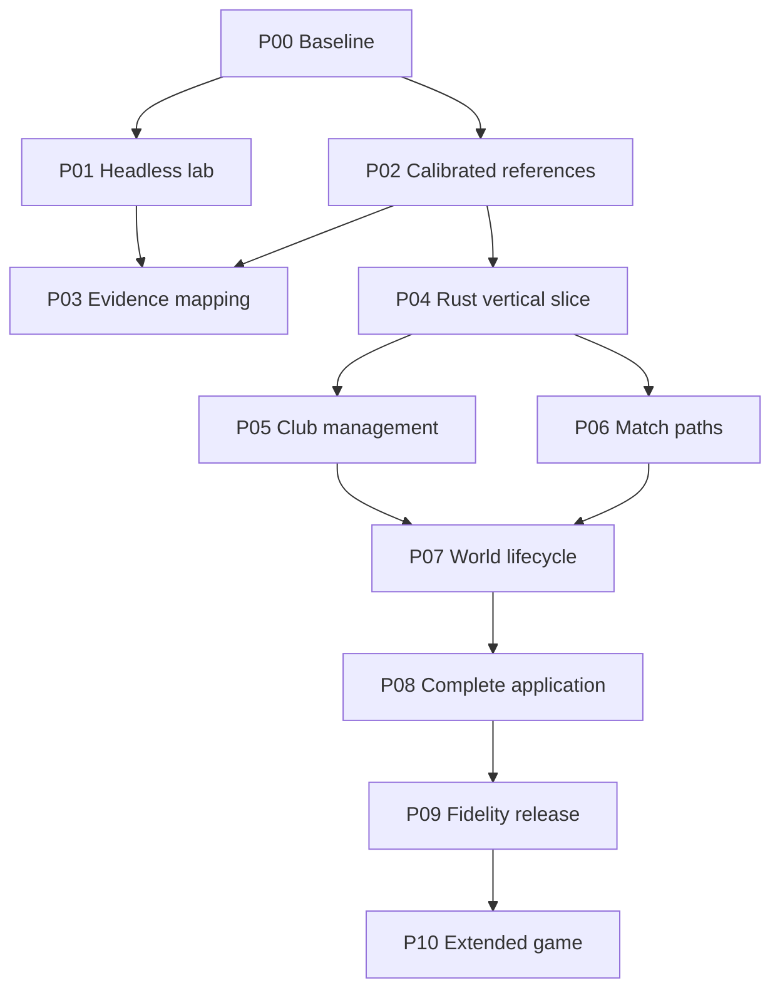

# Canonical implementation roadmap

The phase names, dependencies and exit gates are defined by [ROADMAP.md](../../ROADMAP.md) and the numbered designs in this directory. This is a standalone project plan with plain Markdown phase designs and explicit acceptance gates.

## Dependency graph

P01 service reliability and P02 local reference calibration can progress in parallel after P00. P04 follows P02 without waiting for P03 or Jev. P03 depends on P01/P02 and develops the continuous mapping loop alongside the Rust work. Its optional model evaluation is not a reconstruction prerequisite. Baseline and regression campaigns continue throughout.

## First implementation sequence

These are ordered implementation work packages. Create ordinary repository issues as work is scheduled; the table does not claim existing issue IDs.

| Order | Work package | Acceptance evidence | Dependency |
|---|---|---|---|
| 1 | Pin sources and import the existing map | Input/provenance manifest, count/schema reconciliation, coverage register | Map-only work can start immediately |
| 2 | Build Bosman and run one isolated Rust-CLI job | Qualified private input, binary digest, endpoint and artifacts | 1 plus original files |
| 3 | Local original/Bosman calibration | A/A replay, numeric/RNG cases, deliberate divergence detection | 1, 2; no durable queue required |
| 4A | First Rust native/browser slice | Supported stateful workflow, original-backed parity, save/reload | 3; no Jev or full mapping platform required |
| 4B | Durable queue and 24-hour VPS pilot | Fencing/recovery, successful endpoints, resource measurements | 2 and host access |
| 5 | Continuous mapping and 72-hour qualification | Reviewed useful contracts, valid reproducers, restore and storage limits | 3, 4B |
| 6 | Optional Jev shadow trial | Family-separated labels/holdout and measured routing benefit | Sufficient labelled evidence from 5 |

See [BOOTSTRAP.md](BOOTSTRAP.md) for the small opening deliverables and stop conditions. P05/P06 feature lanes follow P04; the mapping workflow continues in parallel. Later broad fidelity claims require the original-backed evidence appropriate to their scope.

## Whole-game workstreams and closure coverage

| Workstream | Begins | Major delivery | Final release requirement |
|---|---|---|---|
| Executable/functions/globals/data layouts | P00 | P03, continuous | All scoped items classified, reachable blockers resolved |
| Numeric/RNG/calendar compatibility | P02 | P04 | Exact declared corpus and cross-target consistency |
| Database and asset import | P00 inventory | P04, P08 | Supported original inputs documented and tested |
| Save/load and migrations | P02 observations | P04–P09 | Supported original import and new-save continuity |
| Players/staff/training/injuries | P03 research | P05 | Lifecycle and management paths |
| Transfers/contracts/scouting/finances/board | P03 research | P05 | Human and AI decisions and their side effects |
| Detailed and quick matches | P01 observation | P06 | Both paths, interaction and world writeback |
| Competition/world simulation | P01 observation | P07 | All original formats and long-career transitions |
| News, workflow, UI and presentation | P00 inventory | P04–P08 | Complete supported player journeys and human review |
| Supported multi-manager/network modes | P00 inventory | P08 | Verified original scope, no silent exclusion |
| Extensions and data-driven rules | P04 interfaces | P10 | Persisted profiles and faithful-mode noninterference |

## Replanning triggers

Revisit architecture if original/Bosman divergences cannot be bounded; state cannot replay; memory-address semantics defeat the proposed Rust model; browser memory cannot fit representative saves; evidence throughput exceeds review capacity; or sustained VPS cost exceeds budget. Diagnose and record a specific adjustment. Rust remains the chosen core unless the user explicitly changes that decision.

Funding a faster server before resolving a bad comparator only generates uncertainty faster. First measure useful findings per CPU-hour and human review-hour. Full-game reconstruction is a substantial research/product programme; completion cannot be inferred from the imported function count.
